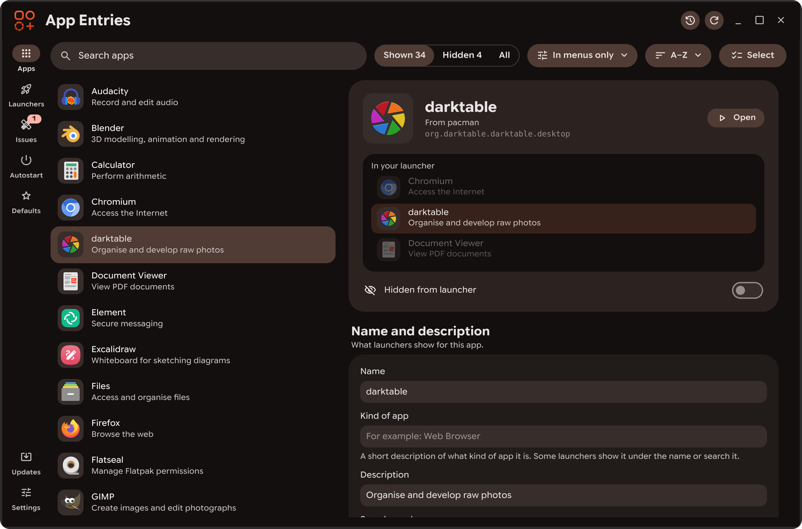
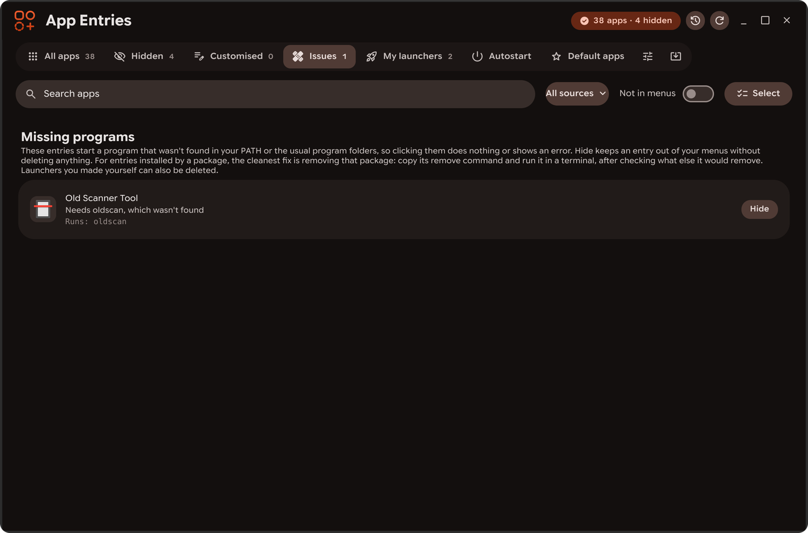
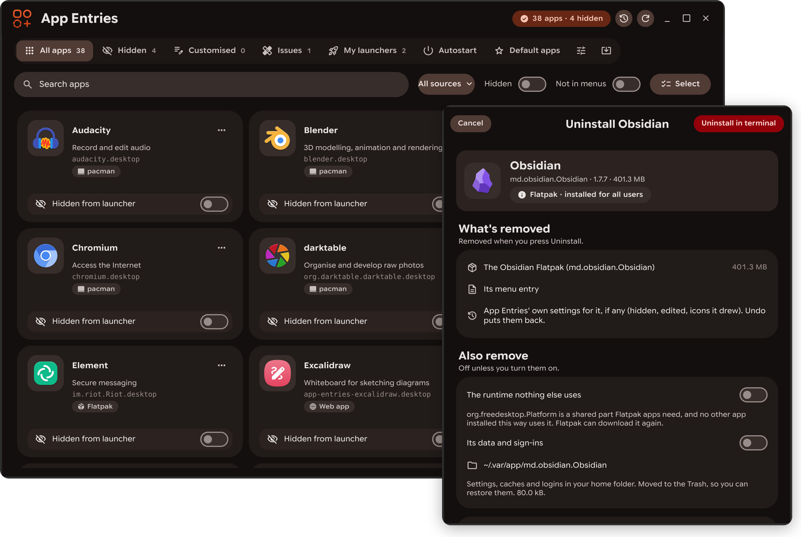
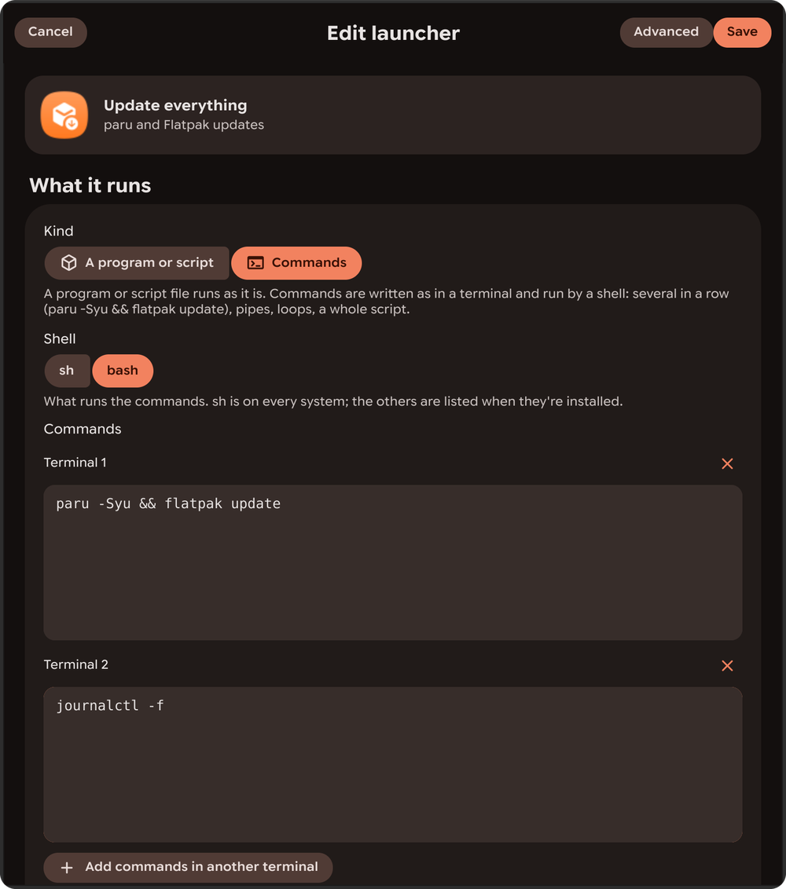
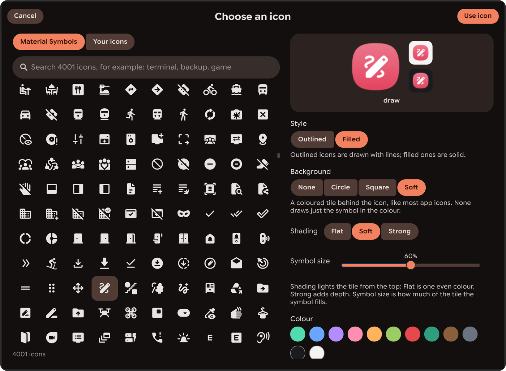
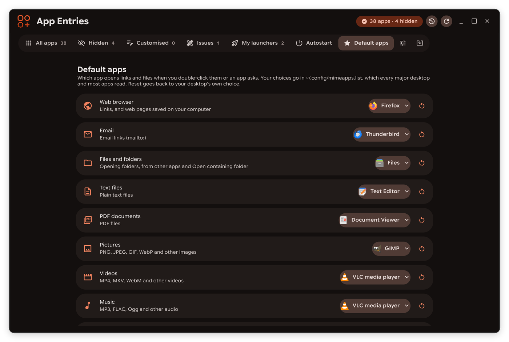
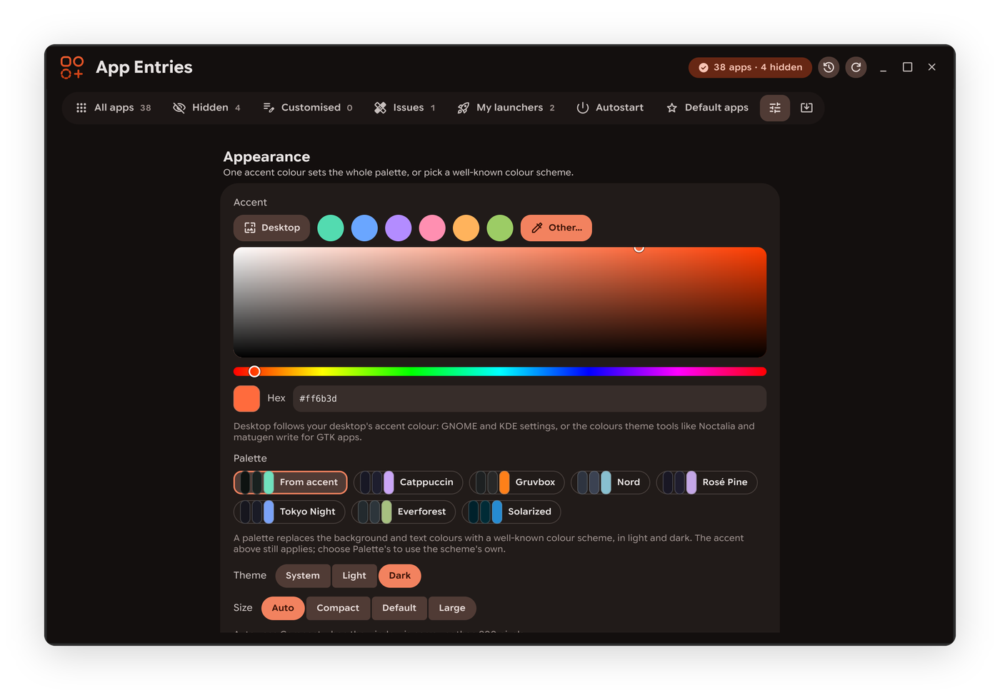

<p align="center">
  
</p>

<h1 align="center">App Entries</h1>

<p align="center">
  A GTK 4 app for Linux that hides, shows and edits app launcher entries. It can also make launchers and web apps, manage autostart entries, choose default apps and uninstall apps. It only changes files in your home folder; uninstalling a package runs your package manager in your own terminal.
</p>

<p align="center">
  
  
  
  
  
  
</p>

<p align="center">
  <a href="#installation">Install</a> ·
  <a href="#features">Features</a> ·
  <a href="#how-it-works">How it works</a> ·
  <a href="#keyboard-shortcuts">Shortcuts</a> ·
  <a href="CHANGELOG.md">Changelog</a>
</p>

<p align="center">
  
</p>

---

> **AI disclosure:** This project was written almost entirely by an AI assistant, with direction and testing by the author. It has been tested on Arch Linux with Hyprland, but not yet on every desktop, so review the code before relying on it.

## Features

**Apps**
- Every installed app in one searchable list: system packages, Flatpak, Snap, AppImage, Steam and your own launchers. **Shown**, **Hidden** or **All**, so hundreds of hidden apps stay out of the way; a Filter menu narrows it to one source, customised or new apps.
- Hide or show an app with the eye on its row, Space, or the switch on its page. Hidden apps still open links and files, and stay in "Open With".
- **Each app has a page** beside the list: how it looks in your launcher, its name, icon and command (edited right there, with Save and Discard), the file types it opens, whether it starts at login, helper apps, the changes made to it with Undo, and Uninstall. Unsaved edits are kept while you look at other apps.
- **Select several** to hide, show, restore, restyle or uninstall many apps at once.
- **Edit** any entry (name, icon, command, environment, folders, desktops, quick actions) with a live view of the file. Editing a system app saves your own copy; *Restore original* puts it back.
- **Open** any app from its page or right-click menu, hidden ones included. Sort A–Z or newest first; apps that appeared since App Entries last looked are marked New.
- **Issues** finds leftover files, missing programs and duplicates, and explains each with a button to fix it.<br>
  <a href="docs/screenshots/issues.png"></a>
- Apps you edited and then uninstalled some other way are hidden from menus with your edits kept, and the edits apply again if you reinstall. Both are options in Issues, each done once with Undo.
- When the list is empty because of the search or the filters, it says how many apps they leave out, with a button to lift each. While searching Shown, it also says when hidden apps match.
- **Uninstall…** for Flatpak, Snap, AppImage, Steam, Distrobox and system packages (pacman, apt, dnf, zypper, rpm-ostree, xbps, apk, eopkg, Portage and Nix). Before anything runs it shows what goes, which other apps and packages need it or go with it, whether it's a default app or starts at login, and the exact command. Data folders and advanced options (like removing what depends on it) are off unless you turn them on, with warnings. Commands that need a password run in your terminal; packages the system or your desktop needs are never offered. History keeps a Reinstall button.
- **Helper apps…** shortcuts to the apps that set up what App Entries doesn't, opened on that app where they allow it: Flatseal, Warehouse, Gear Lever, ProtonUp-Qt, Protontricks, BoxBuddy, DistroShelf, GNOME Settings' and KDE's app permissions, your software centre and Steam. Missing ones show what they do and the Flathub command, run in your terminal only if you ask.

<p align="center">
  
</p>

**Launchers**
- **New launcher** for a program or script, or for commands written as in a terminal (`paru -Syu && flatpak update`, pipes, loops, whole scripts) run by the shell you choose. Add more sets of commands to open each in its own terminal. Terminal options and a live preview of the entry.<br>
  <a href="docs/screenshots/commands-launcher.png"></a>
- **New web app**: a site in its own window with no address bar or tabs, using a Chromium-based browser. It shares your browser's sign-ins, or keeps its own, with an optional dark mode and a window name for docks and window rules.
- **Styled icons** from 4,000 Material Symbols or your own SVGs: tile shape, colour, shading, size and border, with a built-in colour picker. Paste SVG code, download from a link, or use a site's icon.<br>
  <a href="docs/screenshots/icon-picker.png"></a>

**More**
- **Autostart**: turn login programs on and off, or add your own.
- **Default apps**: choose which app opens links, email, folders, text, PDFs, pictures, videos, music and archives, for a whole kind or each type on its own. **By app** lists every file type one app opens (File types… on its page) and makes it the default for any of them. Uses the standard `mimeapps.list`, and also updates Xfce's and KDE's own browser settings.<br>
  <a href="docs/screenshots/default-apps.png"></a>
- **History** of every change, each with Undo, kept between sessions.
- **Export / Import** your changes to set up another computer.
- **Updates** from GitHub releases, installed with one button.
- A **command line** for scripts, and full keyboard and screen reader support.
- Light and dark themes and a responsive layout. The accent can follow your desktop's (GNOME and KDE settings, or the colours Noctalia, matugen, wallust and other theme tools write for GTK apps), and palettes like Catppuccin, Gruvbox, Nord, Rosé Pine, Tokyo Night, Everforest and Solarized restyle the whole app.<br>
  <a href="docs/screenshots/settings.png"></a>

Nothing happens by itself: every option is explained, nothing is written until you press a button, and every change can be undone. The one exception is hiding edited apps that were uninstalled (and showing them again on reinstall), which is on by default, shows a message with Undo, and can be turned off in Issues. App Entries never changes system files itself; only a package manager you run from it, in your terminal, does.

## Installation

```sh
git clone https://github.com/HypestHyper/AppEntries.git
cd AppEntries
./install.sh                  # installs to ~/.local
```

Needs Python 3.9+, GTK 4.6+ and PyGObject. The installer shows the command for your distribution and asks before installing anything missing (`--yes` to skip the question). Use `sudo ./install.sh --system` for `/usr/local`, or `--prefix DIR`.

Updates come from **Updates**, at the bottom of the side rail. To remove it, run `./uninstall.sh` (same options). Add `--restore-apps` to show the apps you hid and turn login programs back on, and `--purge` to delete settings.

## How it works

Launchers read `.desktop` files from `~/.local/share/applications` before the system folders, so a file there with the same name wins. Hiding an app writes a copy of its entry there with `NoDisplay=true`, marked with a checksum so App Entries can tell if you edit it. Showing it again deletes the copy, or removes just that line from a file of your own. Launchers that run commands keep them in a small script in `~/.local/share/app-entries/scripts`, which the entry runs with your chosen shell, so every launcher can start them. Autostart works the same way in `~/.config/autostart`. Default apps are written to `~/.config/mimeapps.list`, the standard file desktops and apps read to decide what opens links and files.

This follows the [Desktop Entry Specification](https://specifications.freedesktop.org/desktop-entry-spec/latest/), so it works with GNOME, KDE Plasma, Xfce, Cinnamon, rofi, wofi, fuzzel and other launchers that read `.desktop` files.

## Command line

```sh
app-entries --list --hidden          # ID, state and name
app-entries --hide steam discord     # by ID or name
app-entries --unhide steam
app-entries --export ~/apps.json     # and --import, which lists the changes first
app-entries --refresh-launchers
app-entries --uninstall discord      # shows what goes and the command, then asks
```

Add `--yes` to skip questions in scripts. See `app-entries --help`.

## Keyboard shortcuts

| Keys | Action |
| --- | --- |
| `Ctrl+F`, or start typing | Search |
| `Alt+1` … `Alt+7` | Go to Apps, Launchers, Issues, Autostart, Defaults, Updates or Settings |
| `Ctrl+N` / `Ctrl+Shift+N` | New launcher / New web app |
| `Enter` or a click on an app | Open its page |
| `Space` on an app | Hide or show it |
| `Menu` or `Shift+F10` on an app | Its options |
| `Ctrl+S` | Save the changes on an app's page |
| `Esc` | Back to the list (narrow windows), or close History |
| `Ctrl+Z` | Undo the last change |
| `Ctrl+H` | History, at the side |
| `Ctrl+R` | Refresh |
| `Ctrl+,` | Settings |

## Files

| What | Where |
| --- | --- |
| Hidden and edited apps, launchers you make | `~/.local/share/applications/` |
| Login programs you changed | `~/.config/autostart/` |
| Default apps | `~/.config/mimeapps.list` |
| Your icons, web apps' own sign-ins | `~/.local/share/app-entries/` |
| History of changes | `~/.local/state/app-entries/history.json` |

## Development

```sh
python3 -m app_entries        # run from the source folder
python3 -m pytest tests       # tests use temporary folders, never your real ones
```

## License

MIT, see [LICENSE](LICENSE). Third-party assets are listed in [THIRD_PARTY.md](THIRD_PARTY.md).
